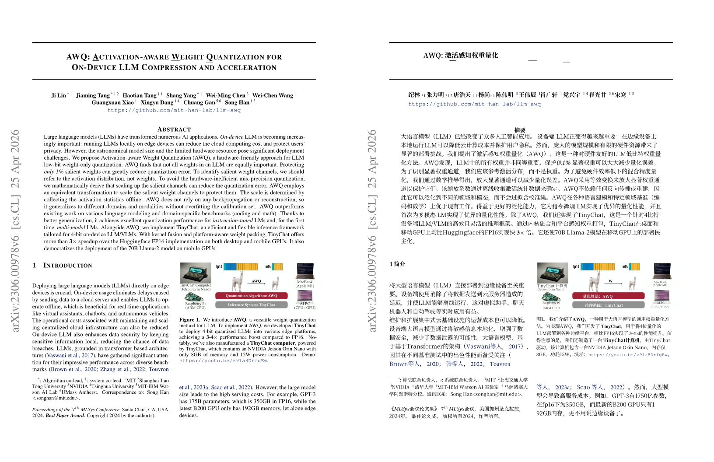
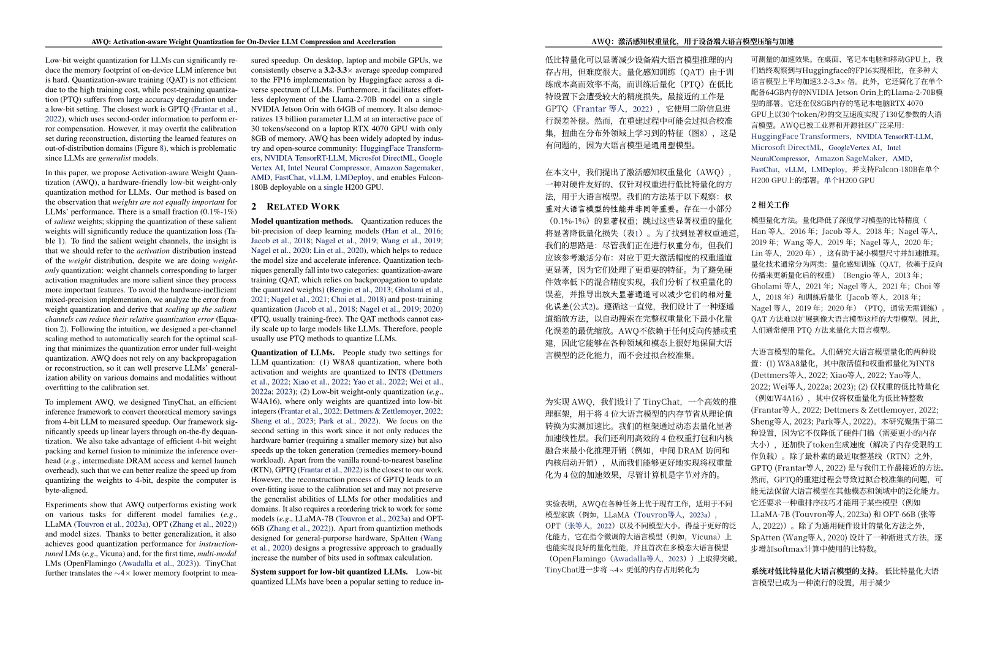
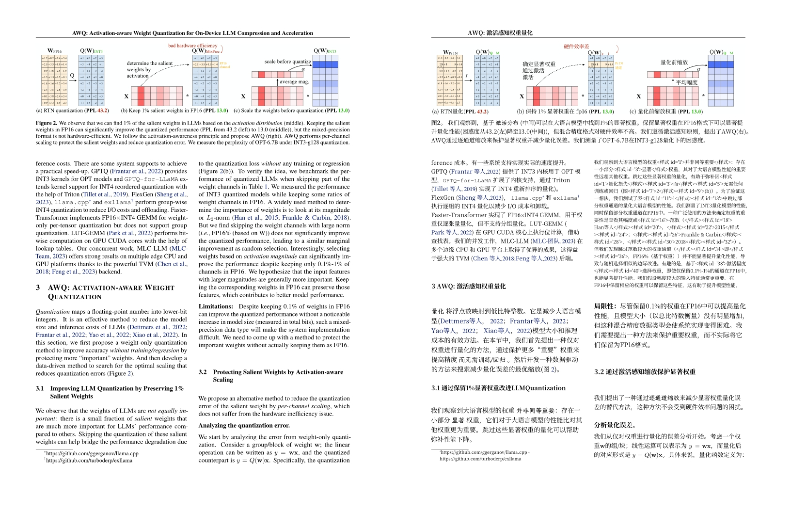

# PDF2zh 中英对照翻译 Skill

把英文论文或技术报告交给 Codex，生成**左侧英文原文、右侧简体中文译文**的 PDF。翻译由固定版本的 PDF2zh-Next 执行。它会尝试保留公式、图表和原页面结构，支持一次处理多份 PDF。

## 实际效果

下面三张截图来自 AWQ 论文的中英对照版，依次展示首页、双栏正文和带图表的页面。左侧是英文原文，右侧是简体中文机器译文。[AWQ 论文原文（arXiv:2306.00978v6）](https://arxiv.org/abs/2306.00978v6)







## 安装到 Codex

克隆仓库后，把里面的 `pdf2zh-bilingual` 文件夹复制到 Codex 的用户 skills 目录。默认是 `~/.codex/skills`。如果配置了 `CODEX_HOME`，目录是 `$CODEX_HOME/skills`。

Windows PowerShell 示例：

```powershell
git clone https://github.com/TongYee325/pdf2zh-bilingual-skill.git
Set-Location pdf2zh-bilingual-skill
$skillRoot = if ($env:CODEX_HOME) { Join-Path $env:CODEX_HOME 'skills' } else { Join-Path $env:USERPROFILE '.codex\skills' }
New-Item -ItemType Directory -Path $skillRoot -Force | Out-Null
Copy-Item -LiteralPath '.\pdf2zh-bilingual' -Destination $skillRoot -Recurse
```

在 Codex 新对话中选择 `$pdf2zh-bilingual`，附上 PDF 或提供本地路径。示例指令：

> 用 $pdf2zh-bilingual 把我选中的三篇英文论文全文翻译成中英对照 PDF，保存到「译文」文件夹。

Codex 会先检查 `uv`、Python 3.12 和脚本依赖。已有环境会直接复用，缺少的组件会在翻译开始前安装。首次翻译时，PDF2zh-Next 会准备版面识别模型和字体。

## 直接运行

在仓库根目录运行。若 `uv --version` 提示命令不存在，Windows 可运行 `winget install --id astral-sh.uv --exact`，有 Homebrew 的 macOS 可运行 `brew install uv`，其他环境可使用官方独立安装器。[uv 官方安装说明](https://docs.astral.sh/uv/getting-started/installation/)

用 `uv python find --no-python-downloads 3.12` 检查 Python 3.12，缺失时运行 `uv python install 3.12`。再检查脚本依赖。此命令不需要传入 PDF。

```sh
uv run --script pdf2zh-bilingual/scripts/translate.py --check-toolchain
```

看到「工具链可用」后，运行翻译命令。

```sh
uv run --script pdf2zh-bilingual/scripts/translate.py "paper.pdf" "another-paper.pdf" --output-dir "译文"
```

可先用仓库内的原创短文试跑。[英文样例](demo/robot-reaction-time.pdf) · [双语样例](demo/robot-reaction-time_中英对照.pdf)

每份译文命名为 `原文件名_中英对照.pdf`。省略 `--output-dir` 时，译文放在各自原文件旁边。同名文件已存在时会保留并提示。原文更新后，可以指定新的输出目录。批量任务在单份翻译失败后会继续处理其余文件，最后以非零状态报告存在失败。

译文可以作为附件加入 Zotero。在 Zotero 中选中文献条目，再用「添加附件 → 附加文件」选择对应双语 PDF。

## 使用条件

- 固定使用 PDF2zh-Next `2.9.0` 和 BabelDOC `0.6.2`。翻译后检查页数、左右并排版式和译文侧的可提取中文。
- 使用内置 SiliconFlow Free 服务，需要联网。服务会接收待翻译文本，可用性和速度由服务方决定。适合可发给该服务处理的 PDF。
- 扫描版 PDF 需要先做 OCR。图片里的文字、复杂表格和多栏排版可能无法完整处理。涉及关键术语和实验结论时，可对照左侧原文。

Skill 代码采用 [AGPL-3.0](LICENSE)。AWQ 截图保留论文署名和版权信息。翻译和 PDF 版面处理分别依赖 [PDF2zh-Next](https://pypi.org/project/pdf2zh-next/2.9.0/) 与 [BabelDOC](https://github.com/funstory-ai/BabelDOC)。
